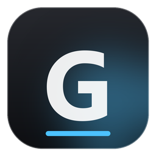
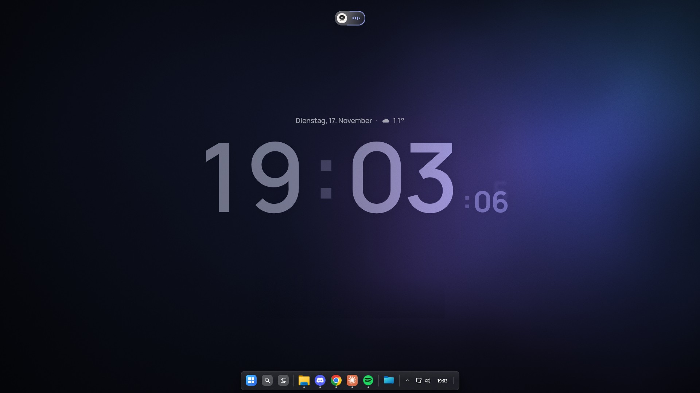
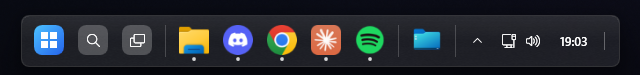

<p align="center">
  
</p>

<h1 align="center">GlassBar</h1>

<p align="center">
  A floating glass dock that replaces the Windows 11 taskbar – with its own natively rendered wallpaper.
  <br><br>
  <a href="https://github.com/Xardas1906/GlassBar/releases/latest"><b>⬇ Download the latest version</b></a>
  ·
  <a href="README.md">Deutsch</a>
</p>



## Features



**Dock**
- Pinned and running apps, window previews, desktop folder with groups and the Windows 11 context menu
- Right-click on apps shows the jump list like Windows does (recent items, tasks)
- Notification area, quick settings, clock, music and weather
- “Show desktop” button on the far right
- Slides out of view when a window covers it; Windows key: first the dock, then Start
- In games: the first press of the Windows key brings up the dock and releases the mouse
- Optionally one dock per monitor, each can be pinned to stay visible
- Customizable start icon: tile, glass, logo only or your own image, with colors and logo styles

**Wallpaper “Still” (native, no browser)**
- Light field (Direct3D), clock with rolling digits, date and weather (Direct2D) – or your Windows wallpaper / a solid color behind clock and pills
- Music with lyrics, water, Pomodoro, alarms/timers, tasks, workouts, prayer times, soundscapes, weather card
- Rain on the glass, flow and glow under the mouse – on all monitors
- Sleeps whenever it is covered

**Settings**
- Everything applies immediately, with search; values next to sliders can be typed in
- Starts with Windows via the Task Scheduler
- One-click updates: Settings › System › Updates
- Language: automatic (like Windows), German or English

> The settings and dock are fully available in English. The pills and cards of the “Still” wallpaper are still German and will be translated next.

## Installation

1. Download `GlassBar-Setup-X.Y.Z.exe` from [Releases](https://github.com/Xardas1906/GlassBar/releases/latest) and run it.
   The installer sets up GlassBar in `C:\Program Files\GlassBar`, optionally with “Start with Windows”,
   and downloads the [.NET 10 Desktop Runtime](https://dotnet.microsoft.com/download/dotnet/10.0) from Microsoft if it is missing.
2. GlassBar starts automatically. The Windows taskbar is hidden while GlassBar is running.
3. Right-click an empty spot on the dock › **Settings…**

Without the installer: unzip `GlassBar-vX.Y.Z-win-x64.zip` into a permanent folder and run `GlassBar.exe`
(requires the .NET 10 Desktop Runtime).

If Wallpaper Engine is running, stop its wallpaper before turning on “Still” in GlassBar.

## Quit and uninstall

- **Quit:** right-click the dock › *Quit GlassBar* – the normal Windows taskbar comes back.
  If it is missing after a crash, start GlassBar once and quit it, or restart Windows Explorer in Task Manager.
- **Uninstall:** Windows Settings › Apps › GlassBar › Uninstall. GlassBar is closed, autostart is removed,
  and you can choose whether your settings are deleted as well.

## Bugs and ideas

Please use [Issues](https://github.com/Xardas1906/GlassBar/issues/new/choose) – there are templates for bug reports and ideas
(English is fine).

## Building

Requirements: Windows 11, .NET 10 SDK.

```
dotnet build GlassBar/GlassBar.csproj -c Release
```

Release with zip and installer (requires [Inno Setup 6](https://jrsoftware.org/isinfo.php), e.g. `winget install JRSoftware.InnoSetup`):

```
powershell -File installer\build.ps1
```

## Original and credits

The wallpaper in GlassBar is an unofficial recreation of
**[“Still – Minimal Wallpaper for Your Focus”](https://steamcommunity.com/sharedfiles/filedetails/?id=3829782620)**
by **[MrShadow](https://steamcommunity.com/id/gj_emon)** from the Steam Workshop for Wallpaper Engine.
The idea, design and features come from the original – all rights to it belong to its author.
GlassBar is not affiliated with MrShadow or Wallpaper Engine. If you like the wallpaper, please support the original in the Workshop.

Should the author object to the recreation, it will be removed on request.

## License

The GlassBar source code is licensed under the [MIT License](LICENSE).
The idea and design of the “Still” wallpaper are excluded – they belong to the original author (see above).
