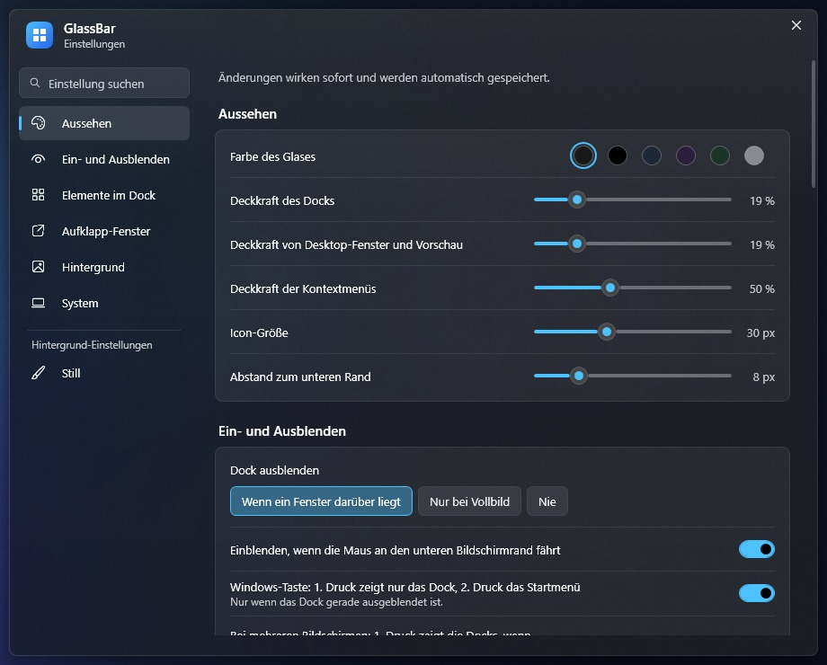

<p align="center">
  
</p>

<h1 align="center">GlassBar</h1>

<p align="center">
  Ein schwebendes Glas-Dock als Ersatz für die Windows-11-Taskleiste – mit eigenem, nativ gezeichnetem Hintergrund.
  <br><br>
  <a href="https://github.com/Xardas1906/GlassBar/releases/latest"><b>⬇ Neueste Version herunterladen</b></a>
</p>


> **English:** GlassBar replaces the Windows 11 taskbar with a floating glass dock and is available in English (Settings › System › Language). → **[Read the English README](README.en.md)**

## Funktionen


**Dock**
- Angeheftete und laufende Programme, Fenstervorschau, Desktop-Ordner mit Gruppen und Windows-11-Kontextmenü
- Rechtsklick auf Programme zeigt die Sprungliste wie bei Windows (zuletzt verwendet, Aufgaben)
- Infobereich, Schnelleinstellungen, Uhr, Musik und Wetter
- Knopf „Desktop anzeigen“ ganz rechts
- Fährt nach unten weg, wenn ein Fenster darüberliegt; Windows-Taste: erst Dock, dann Startmenü
- Im Spiel: Der erste Druck auf die Windows-Taste holt das Dock und gibt die Maus frei
- Auf Wunsch ein Dock pro Bildschirm
- Fortschrittsbalken (z. B. Downloads) und Badges (z. B. ungelesene Nachrichten) auf den Programmsymbolen
- Win+1 … 9 öffnet das Programm an dieser Stelle im Dock; Mausrad über Musik/Schnelleinstellungen ändert die Lautstärke
- Design: dunkel, hell oder wie Windows
- Start-Symbol personalisierbar: Kachel, Glas, nur Logo oder eigenes Bild, mit eigener Farbe und Logo-Stil

**Hintergrund „Still“ (nativ, ohne Browser)**
- Lichtfeld, Polarlicht, Kaustik, Bokeh-Lichter oder Nebel (Direct3D, in den Farben der Palette, reagieren auf Musik und Maus) – oder das Windows-Hintergrundbild / einfarbig
- Uhr mit rollenden Ziffern, Datum und Wetter (Direct2D)
- Musik mit Liedtexten, Wasser, Pomodoro, Wecker/Timer, Aufgaben, Training, Gebetszeiten, Klanglandschaften, Wetterkarte
- Regen auf der Scheibe, Strömung und Leuchten unter der Maus – auf allen Bildschirmen
- Schläft, sobald er verdeckt ist

**Einstellungen**



- Alles wirkt sofort, mit Suche; Werte neben Reglern lassen sich direkt eintippen
- Startet mit Windows über die Aufgabenplanung
- Updates mit einem Klick: Einstellungen › System › Updates (geprüft per SHA-256; GlassBar sucht einmal am Tag selbst)
- Stürzt GlassBar ab, holt ein kleiner Wächter-Prozess die Windows-Taskleiste zurück und startet GlassBar neu
- Sprache: automatisch (wie Windows), Deutsch oder Englisch

## Installation

1. `GlassBar-Setup-X.Y.Z.exe` aus den [Releases](https://github.com/Xardas1906/GlassBar/releases/latest) laden und starten.
   Der Installer richtet GlassBar unter `C:\Program Files\GlassBar` ein, auf Wunsch mit „Mit Windows starten“,
   und lädt die [.NET 10 Desktop Runtime](https://dotnet.microsoft.com/download/dotnet/10.0) von Microsoft nach, falls sie fehlt.
2. GlassBar startet danach automatisch. Die Windows-Taskleiste wird ausgeblendet, solange GlassBar läuft.
3. Rechtsklick auf eine freie Stelle im Dock › **Einstellungen …**

Ohne Installer: das Zip `GlassBar-vX.Y.Z-win-x64.zip` in einen festen Ordner entpacken und `GlassBar.exe` starten
(dafür muss die .NET 10 Desktop Runtime installiert sein).

Wenn Wallpaper Engine läuft, dort den Hintergrund beenden, bevor du „Still“ in GlassBar einschaltest.

## Beenden und Deinstallieren

- **Beenden:** Rechtsklick aufs Dock › *GlassBar beenden* – die normale Windows-Taskleiste kommt zurück.
  Nach einem Absturz holt der Wächter sie automatisch zurück. Fehlt sie trotzdem, GlassBar einmal starten und so beenden
  oder im Task-Manager den Windows-Explorer neu starten.
- **Deinstallieren:** Windows-Einstellungen › Apps › GlassBar › Deinstallieren. GlassBar wird dabei beendet,
  der Autostart entfernt, und du kannst wählen, ob auch die Einstellungen gelöscht werden.
  (Zip-Version: „Mit Windows starten“ ausschalten, beenden, Ordner und `%AppData%\GlassBar` löschen.)

## Fehler und Ideen

Gerne über [Issues](https://github.com/Xardas1906/GlassBar/issues/new/choose) – es gibt Vorlagen für Fehlerberichte und Ideen.

## Selbst bauen

Voraussetzungen: Windows 11, .NET 10 SDK.

```
dotnet build GlassBar/GlassBar.csproj -c Release
```

Tests (benutzen einen eigenen Temp-Ordner, nie deine echten Einstellungen):

```
dotnet test GlassBar.Tests/GlassBar.Tests.csproj
```

GitHub Actions baut und testet jeden Push. Ein Versions-Tag (z. B. `v1.3.0`, passend zu `<Version>` in `GlassBar.csproj`)
legt automatisch einen Release-Entwurf mit Zip und Installer an.

Release mit Zip und Installer (braucht [Inno Setup 6](https://jrsoftware.org/isinfo.php), z. B. `winget install JRSoftware.InnoSetup`):

```
powershell -File installer\build.ps1
```

## Original und Danksagung

Der Hintergrund in GlassBar ist ein inoffizieller Nachbau von
**[„Still – Minimal Wallpaper for Your Focus“](https://steamcommunity.com/sharedfiles/filedetails/?id=3829782620)**
von **[MrShadow](https://steamcommunity.com/id/gj_emon)** aus dem Steam Workshop für Wallpaper Engine.
Idee, Gestaltung und Funktionen stammen vom Original – alle Rechte daran liegen bei seinem Autor.
GlassBar steht in keiner Verbindung zu MrShadow oder Wallpaper Engine. Wenn dir der Hintergrund gefällt,
unterstütze bitte das Original im Workshop.

Sollte der Autor mit dem Nachbau nicht einverstanden sein, wird er auf Wunsch entfernt.

## Lizenz

Der Quellcode von GlassBar steht unter der [MIT-Lizenz](LICENSE).
Ausgenommen sind Idee und Gestaltung des Hintergrunds „Still“ – sie gehören dem Original-Autor (siehe oben).
