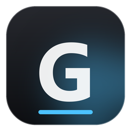
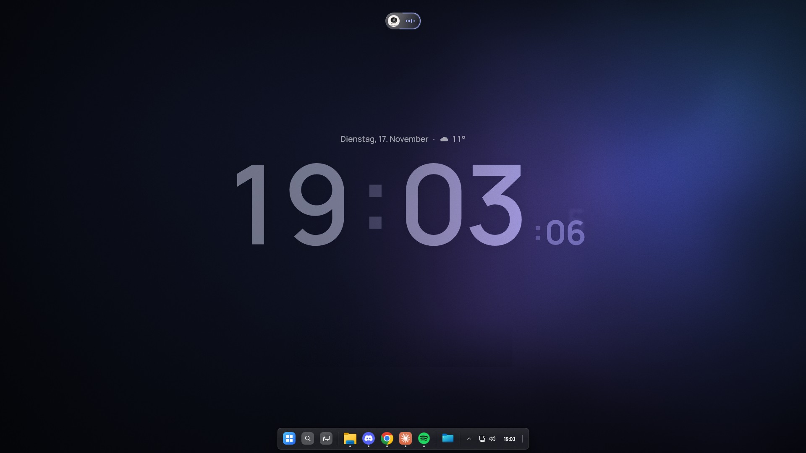
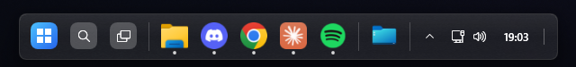

<p align="center">
  
</p>

<h1 align="center">GlassBar</h1>

<p align="center">
  Ein schwebendes Glas-Dock als Ersatz für die Windows-11-Taskleiste – mit eigenem, nativ gezeichnetem Hintergrund.
  <br><br>
  <a href="https://github.com/Xardas1906/GlassBar/releases/latest"><b>⬇ Neueste Version herunterladen</b></a>
</p>



> **English:** GlassBar replaces the Windows 11 taskbar with a floating glass dock (WPF, .NET 10) and ships a native
> Direct3D/Direct2D recreation of the "Still" wallpaper. The app and its settings are in German.
> Download the zip from [Releases](https://github.com/Xardas1906/GlassBar/releases/latest), unzip and run `GlassBar.exe`
> (requires Windows 11 and the [.NET 10 Desktop Runtime](https://dotnet.microsoft.com/download/dotnet/10.0)).

## Funktionen



**Dock**
- Angeheftete und laufende Programme, Fenstervorschau, Desktop-Ordner mit Gruppen und Windows-11-Kontextmenü
- Rechtsklick auf Programme zeigt die Sprungliste wie bei Windows (zuletzt verwendet, Aufgaben)
- Infobereich, Schnelleinstellungen, Uhr, Musik und Wetter
- Knopf „Desktop anzeigen“ ganz rechts
- Fährt nach unten weg, wenn ein Fenster darüberliegt; Windows-Taste: erst Dock, dann Startmenü
- Im Spiel: Der erste Druck auf die Windows-Taste holt das Dock und gibt die Maus frei
- Auf Wunsch ein Dock pro Bildschirm
- Start-Symbol personalisierbar: Kachel, Glas, nur Logo oder eigenes Bild, mit eigener Farbe und Logo-Stil

**Hintergrund „Still“ (nativ, ohne Browser)**
- Lichtfeld (Direct3D), Uhr mit rollenden Ziffern, Datum und Wetter (Direct2D)
- Musik mit Liedtexten, Wasser, Pomodoro, Wecker/Timer, Aufgaben, Training, Gebetszeiten, Klanglandschaften, Wetterkarte
- Regen auf der Scheibe, Strömung und Leuchten unter der Maus – auf allen Bildschirmen
- Schläft, sobald er verdeckt ist

**Einstellungen**


- Alles wirkt sofort, mit Suche; Werte neben Reglern lassen sich direkt eintippen
- Startet mit Windows über die Aufgabenplanung
- Updates mit einem Klick: Einstellungen › System › Updates

## Installation

1. Die [.NET 10 Desktop Runtime (x64)](https://dotnet.microsoft.com/download/dotnet/10.0) installieren, falls noch nicht vorhanden.
2. `GlassBar-vX.Y.Z-win-x64.zip` aus den [Releases](https://github.com/Xardas1906/GlassBar/releases/latest) laden
   und in einen festen Ordner entpacken, z. B. `C:\GlassBar`.
3. `GlassBar.exe` starten. Die Windows-Taskleiste wird ausgeblendet, solange GlassBar läuft.
4. Rechtsklick auf eine freie Stelle im Dock › **Einstellungen …** – dort auch „Mit Windows starten“.

Wenn Wallpaper Engine läuft, dort den Hintergrund beenden, bevor du „Still“ in GlassBar einschaltest.

## Beenden und Deinstallieren

- **Beenden:** Rechtsklick aufs Dock › *GlassBar beenden* – die normale Windows-Taskleiste kommt zurück.
  Fehlt sie nach einem Absturz, GlassBar einmal starten und so beenden oder im Task-Manager den Windows-Explorer neu starten.
- **Deinstallieren:** In den Einstellungen „Mit Windows starten“ ausschalten, GlassBar beenden, den Programmordner löschen
  und auf Wunsch die Einstellungen unter `%AppData%\GlassBar` entfernen.

## Fehler und Ideen

Gerne über [Issues](https://github.com/Xardas1906/GlassBar/issues/new/choose) – es gibt Vorlagen für Fehlerberichte und Ideen.

## Selbst bauen

Voraussetzungen: Windows 11, .NET 10 SDK.

```
dotnet build GlassBar/GlassBar.csproj -c Release
```

## Original und Danksagung

Der Hintergrund in GlassBar ist ein inoffizieller Nachbau von
**[„Still – Minimal Wallpaper for Your Focus“](https://steamcommunity.com/sharedfiles/filedetails/?id=3829782620)**
von **[MrShadow](https://steamcommunity.com/id/gj_emon)** aus dem Steam Workshop für Wallpaper Engine.
Idee, Gestaltung und Funktionen stammen vom Original – alle Rechte daran liegen bei seinem Autor.
GlassBar steht in keiner Verbindung zu MrShadow oder Wallpaper Engine. Wenn dir der Hintergrund gefällt,
unterstütze bitte das Original im Workshop.

Sollte der Autor mit dem Nachbau nicht einverstanden sein, wird er auf Wunsch entfernt.

## Lizenz

Der Quellcode von GlassBar steht unter der [MIT-Lizenz](LICENSE).
Ausgenommen sind Idee und Gestaltung des Hintergrunds „Still“ – sie gehören dem Original-Autor (siehe oben).
